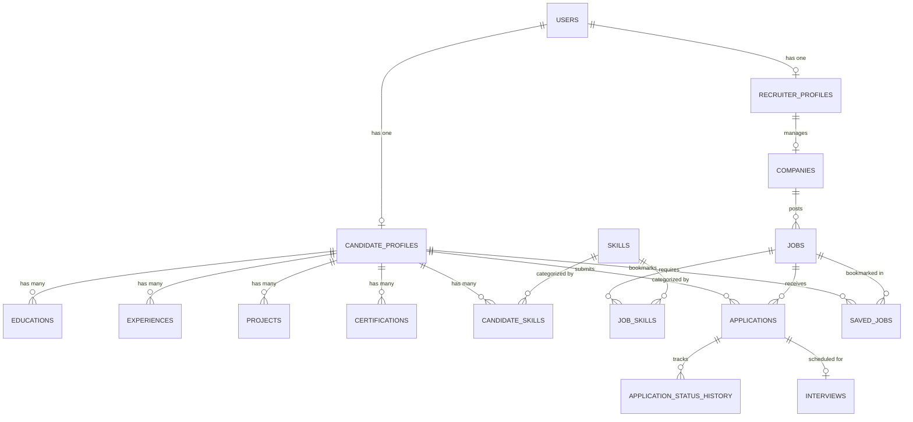

# CareerConnect — Full-Stack Recruitment & Career Intelligence Platform

CareerConnect is an integrated, full-stack recruitment and career intelligence platform connecting **Candidates**, **Recruiters**, and **System Administrators**. It features role-based workflows, comprehensive candidate profile management, deterministic and AI-ready Resume Intelligence, recruiter job and company management, candidate application tracking, interview scheduling, and an administrative control center.

---

## 🌐 Live Production Deployments

| Component | Platform | Live URL | Status |
| :--- | :--- | :--- | :--- |
| **Frontend Web App** | **Vercel** | **[https://careerconnect-frontend-nine.vercel.app](https://careerconnect-frontend-nine.vercel.app)** |  |
| **Backend REST API** | **Render** | **[https://careerconnect-backend-fx39.onrender.com](https://careerconnect-backend-fx39.onrender.com)** |  |
| **Database** | **Aiven MySQL** | Managed Cloud MySQL 8.4 TLS/SSL |  |
| **Source Repository** | **GitHub** | **[https://github.com/KumarSamratSingh1/CareerConnect](https://github.com/KumarSamratSingh1/CareerConnect)** |  |
| **API Health Check** | **Render** | `https://careerconnect-backend-fx39.onrender.com/api/v1/health` | `{"service":"careerconnect-backend","status":"UP"}` |

---

## 1. Project Overview & Architecture

### Target Production Topology

```
+-------------------------------------------------------------+
|                     Client Web Browser                      |
+-------------------------------------------------------------+
                              |
                              | HTTPS (SPA Navigation)
                              v
+-------------------------------------------------------------+
|             Vercel Frontend (Vite + React 19)               |
|         https://careerconnect-frontend-nine.vercel.app      |
+-------------------------------------------------------------+
                              |
                              | HTTPS REST API (CORS Enabled)
                              v
+-------------------------------------------------------------+
|             Render Backend (Docker / Spring Boot 4)         |
|         https://careerconnect-backend-fx39.onrender.com     |
+-------------------------------------------------------------+
                              |
                              | MySQL TLS / SSL (Port 19016)
                              v
+-------------------------------------------------------------+
|             Aiven Managed MySQL Cloud Database              |
|        careerconnect-mysql-kumarsamratsingh890-3956         |
+-------------------------------------------------------------+
```

### Workspace Structure

```text
CareerConnectProject/
├── careerconnect-backend/     # Spring Boot 4.1.1 / Java 21 REST API
│   ├── src/main/java/...      # Controllers, Services, Repositories, Entities, DTOs
│   ├── src/test/java/...      # 146 Unit & Integration Tests (100% Green)
│   ├── pom.xml                # Maven Dependencies & Plugins
│   └── .env.example           # Backend environment variable template
│
└── careerconnect-frontend/    # React 19 / Vite 8 Single Page Application
    ├── src/
    │   ├── api/               # Axios API client & typed service modules
    │   ├── components/        # UI components (Button, Modal, Card, Badge, etc.)
    │   ├── context/           # AuthContext & ThemeContext
    │   ├── pages/             # Public, Candidate, Recruiter, Admin views
    │   └── routes/            # Route guards (ProtectedRoute, PublicOnlyRoute)
    ├── package.json           # Frontend dependencies & build scripts
    └── .env.example           # Frontend environment variable template
```

### Technology Stack

#### Backend
- **Language & Runtime**: Java 21 (LTS)
- **Framework**: Spring Boot 4.1.1 (Jakarta EE namespace)
- **Security**: Spring Security 6 with stateless JWT (`io.jsonwebtoken:jjwt:0.12.6`)
- **Data & Persistence**: Spring Data JPA & Hibernate with MySQL
- **Document Processing**: Apache PDFBox 3.0.4 & Apache POI 5.4.0 (DOCX)
- **AI Integration**: Google API Client / Gemini 3.8-flash (kept disabled by default for candidate data privacy)
- **Testing**: JUnit 5, Mockito, Spring Boot MockMvc (146 automated tests)

#### Frontend
- **Framework**: React 19 + Vite 8
- **Routing**: React Router 7 (`react-router-dom`)
- **HTTP Client**: Axios with Bearer token interceptor and 401 session expiration handler
- **Icons**: Lucide React
- **Styling**: Curated Vanilla CSS Design System with dark mode tokens, micro-animations, glassmorphism, responsive breakpoints

---

## 2. Resume Intelligence (RI-3)

CareerConnect features **Resume Intelligence (RI-3)**, enabling candidates to import their resume data directly into their profile with complete privacy, granular candidate consent, and safe partial imports.

### Workflow
1. **Document Upload**: Candidate uploads a PDF or DOCX file (up to 10MB).
2. **Deterministic Extraction**: The backend parser extracts text via Apache PDFBox/POI and runs deterministic rule-based section and pattern recognizers.
3. **Editable Draft Review**: The candidate sees extracted personal details, social links, educations, work experiences, skills, projects, and certifications.
4. **Per-Record & Per-Field Selection**: Every record has an individual opt-in toggle; fields are editable before persistence.
5. **Review Flags**: Low-confidence or parser-flagged fields display clear "Review Required" visual indicators.
6. **Overwrite Protection**: If extracted personal details or social links conflict with existing saved data, explicit confirmation checkboxes are required (`approvePersonalDetailsOverwrite`, `approveSocialLinksOverwrite`).
7. **Two-Layer Duplicate Detection**:
   - **Layer 1 (Within-Request)**: Prevents accidental duplicate entries in the same submission.
   - **Layer 2 (Against Database)**: Uses 5-field normalized composite keys for education (`institution + degree + fieldOfStudy + startDate + endDate`) and experience (`companyName + jobTitle + startDate + endDate + currentlyWorking`).
8. **Safe Partial Import**: Valid records are persisted; invalid or duplicate items are reported with clear human-readable reasons in the summary response.
9. **Instant Profile Refresh**: On completion, the candidate profile is immediately refreshed.

### Privacy & AI Configuration
- `RESUME_AI_ENABLED=false` by default.
- Resume text is **never** transmitted to external AI endpoints without explicit candidate consent enforced on both frontend and backend.
- Fallback to deterministic rule-based extraction ensures 100% offline reliability.

---

## 3. Database Design



### Table Definitions
- `users`: `id`, `email`, `password`, `role` (CANDIDATE, RECRUITER, ADMIN), `enabled`, timestamps.
- `candidate_profiles`: `id`, `user_id` (FK), `fullName`, `phone`, `resumeUrl`, `linkedInUrl`, `gitHubUrl`, `portfolioUrl`, timestamps.
- `educations`: `id`, `candidate_profile_id` (FK), `institution`, `degree`, `fieldOfStudy`, `startDate`, `endDate`, `currentlyStudying`.
- `experiences`: `id`, `candidate_profile_id` (FK), `companyName`, `jobTitle`, `description`, `startDate`, `endDate`, `currentlyWorking`.
- `skills`: `id`, `name` (unique, lowercase normalized).
- `projects`: `id`, `candidate_profile_id` (FK), `title`, `description`, `technologies`.
- `certifications`: `id`, `candidate_profile_id` (FK), `name`, `issuingOrganization`, `issueDate`, `expiryDate`.
- `companies`: `id`, `name`, `website`, `location`, `description`, `verificationStatus` (PENDING, VERIFIED, REJECTED).
- `jobs`: `id`, `company_id` (FK), `recruiter_id` (FK), `title`, `description`, `jobType`, `workplaceType`, `location`, `salaryMin`, `salaryMax`, `status` (OPEN, CLOSED), `expiresAt`.
- `applications`: `id`, `job_id` (FK), `candidate_profile_id` (FK), `status` (APPLIED, UNDER_REVIEW, SHORTLISTED, INTERVIEW_SCHEDULED, SELECTED, REJECTED, WITHDRAWN).
- `application_status_history`: `id`, `application_id` (FK), `status`, `notes`, `changedAt`.
- `interviews`: `id`, `application_id` (FK), `scheduledAt`, `meetingLink`, `location`, `status` (SCHEDULED, COMPLETED, CANCELLED).
- `saved_jobs`: `id`, `candidate_profile_id` (FK), `job_id` (FK).

---

## 4. API Overview

All API endpoints reside under `/api/v1`.

### Public Endpoints
- `POST /api/v1/auth/register` — Candidate or Recruiter account registration
- `POST /api/v1/auth/login` — Authentication returning JWT token
- `POST /api/v1/auth/google` — Optional Google OAuth2 authentication
- `GET /api/v1/jobs` — Browse open job and internship postings (with search, location, jobType filters)
- `GET /api/v1/jobs/{jobId}` — View single job posting details

### Candidate Endpoints (`ROLE_CANDIDATE`)
- `GET /api/v1/candidate/profile` — Fetch candidate profile and sub-resources
- `POST /api/v1/candidate/profile` — Create initial basic profile
- `PUT /api/v1/candidate/profile` — Update basic profile information
- `POST /api/v1/candidate/resume/parse` — Parse resume document into structured draft (Multipart)
- `POST /api/v1/candidate/resume/import` — Import candidate-approved and edited draft data
- `GET|POST|PUT|DELETE /api/v1/candidate/educations` — Manage education entries
- `GET|POST|PUT|DELETE /api/v1/candidate/experiences` — Manage work experience entries
- `GET|POST|DELETE /api/v1/candidate/skills` — Manage profile skills
- `GET|POST /api/v1/candidate/applications` — List submitted applications and apply to jobs
- `DELETE /api/v1/candidate/applications/{id}/withdraw` — Withdraw pending application
- `GET|POST|DELETE /api/v1/candidate/saved-jobs` — Bookmark and retrieve saved jobs
- `GET /api/v1/candidate/interviews` — List scheduled interview appointments

### Recruiter Endpoints (`ROLE_RECRUITER`)
- `GET|POST|PUT /api/v1/recruiter/profile` — Recruiter profile management
- `GET|POST|PUT /api/v1/recruiter/company` — Managed company profile
- `GET|POST|PUT /api/v1/recruiter/jobs` — Post, update, and close job listings
- `GET /api/v1/recruiter/applications` — List applications across company jobs
- `PATCH /api/v1/recruiter/applications/{id}/status` — Update application status
- `GET|POST|PUT /api/v1/recruiter/interviews` — Schedule and update interviews

### Admin Endpoints (`ROLE_ADMIN`)
- `GET /api/v1/admin/dashboard` — Platform metric counters (users, companies, jobs, applications)
- `GET /api/v1/admin/users` — List and filter platform users
- `PATCH /api/v1/admin/users/{id}/enabled` — Enable or suspend user account
- `GET /api/v1/admin/companies` — List registered companies
- `PATCH /api/v1/admin/companies/{id}/verification` — Verify or reject company profiles
- `GET|PATCH /api/v1/admin/jobs` — Monitor listings and close policy-violating jobs
- `GET /api/v1/admin/applications` — Global read-only application audit
- `GET /api/v1/admin/interviews` — Global read-only interview audit

---

## 5. Setup & Startup Instructions

### Prerequisites
- Java 21 JDK installed (`java -version`)
- Node.js 18+ and npm installed (`node -v`)
- MySQL 8.x database running on port 3306

### Backend Setup
1. Open terminal in `careerconnect-backend`:
   ```powershell
   cd careerconnect-backend
   ```
2. Copy environment template and configure MySQL credentials:
   ```powershell
   copy .env.example .env
   ```
   Edit `.env` with your MySQL root password:
   ```properties
   DB_URL=jdbc:mysql://localhost:3306/careerconnect?createDatabaseIfNotExist=true&useSSL=false&allowPublicKeyRetrieval=true&serverTimezone=UTC
   DB_USERNAME=root
   DB_PASSWORD=YourLocalMySQLPassword
   JWT_SECRET=MDEyMzQ1Njc4OTAxMjM0NTY3ODkwMTIzNDU2Nzg5MDE=
   ADMIN_EMAIL=admin@careerconnect.com
   ADMIN_PASSWORD=AdminSecurePassword123!
   ```
3. Run test verification:
   ```powershell
   .\mvnw.cmd clean test
   ```
4. Start Spring Boot dev server:
   ```powershell
   .\mvnw.cmd spring-boot:run
   ```
   Backend will start at `http://localhost:8080`.

### Frontend Setup
1. Open a second terminal in `careerconnect-frontend`:
   ```powershell
   cd careerconnect-frontend
   ```
2. Copy environment template:
   ```powershell
   copy .env.example .env
   ```
   Verify `.env` has:
   ```properties
   VITE_API_BASE_URL=http://localhost:8080/api/v1
   ```
3. Install dependencies:
   ```powershell
   npm install
   ```
4. Verify code quality and build:
   ```powershell
   npm run lint
   npm run build
   ```
5. Start the Vite dev server:
   ```powershell
   npm run dev
   ```
   Frontend will start at `http://localhost:5173`.

---

## 6. Demonstration Sequence

Follow this 8-step script for an academic project presentation:

1. **Candidate Registration & Login**:
   - Navigate to `http://localhost:5173/register`.
   - Register a new candidate account (e.g. `alex@example.com` / `Password123!`).
   - Sign in to reach the **Candidate Portal Dashboard**.
2. **Candidate Profile Inspection**:
   - Navigate to **My Profile** (`/candidate/profile`).
   - Notice profile strength meter and section breakdown.
3. **Resume Upload & Parsing (Resume Intelligence RI-3)**:
   - Click **Resume Import** in the sidebar or "Import Resume" button on the profile.
   - Drag and drop a PDF or DOCX resume document.
   - Click **Extract & Review Resume**.
4. **Draft Review & Approved Import**:
   - Inspect the extracted sections: Personal Details, Social Links, Education, Experience, Skills, Projects, and Certifications.
   - Notice individual selection checkboxes and "Review Required" badges.
   - Edit any field (e.g., degree or institution name).
   - If profile details already exist, check the explicit overwrite confirmation checkbox.
   - Click **Approve & Import Selected**.
   - Review the final Import Summary showing counts of imported and skipped records.
   - Click **View Updated Profile** to verify the data is now live.
5. **Job Search & Application**:
   - Click **Browse Jobs** (`/jobs`).
   - Search by keyword (e.g. "Software", "Java") and filter by workplace type.
   - Click into a job card to open **Job Details** (`/jobs/:id`).
   - Click **Apply Now**, review qualifications, and submit the application.
   - View your active submission under **Applications** (`/candidate/applications`).
6. **Recruiter Login & Job Posting**:
   - Log out and sign in with a recruiter account (or register one with role "Recruiter").
   - Complete company profile under **Company Profile** (`/recruiter/company`).
   - Navigate to **Job Postings** (`/recruiter/jobs`).
   - Click **Post New Job**, fill in title, description, skills, salary range, and publish.
7. **Recruiter Application Management & Interview Scheduling**:
   - Navigate to **Applications** (`/recruiter/applications`).
   - Review the candidate's application, attached resume URL, educations, and skills.
   - Update application status to **Shortlisted**.
   - Click **Schedule Interview**, specify date/time and meeting link.
   - Status updates automatically to **Interview Scheduled**.
8. **Admin Control Center**:
   - Sign in as administrator (`admin@careerconnect.com` / `AdminSecurePassword123!`).
   - Navigate to **Admin Dashboard** (`/admin/dashboard`) to view platform metric cards.
   - Go to **User Management** (`/admin/users`) to review or suspend users.
   - Go to **Companies** (`/admin/companies`) to verify recruiter companies.
   - Go to **Job Postings** (`/admin/jobs`) to audit listings across the platform.

---

## 7. Environment Variables Reference

### Backend (Render / Production)

| Variable Name | Required | Default / Format | Description |
| :--- | :---: | :--- | :--- |
| `DB_URL` | **Yes** | `jdbc:mysql://<HOST>:<PORT>/<DB>?sslMode=REQUIRED` | MySQL JDBC connection string with TLS/SSL |
| `DB_USERNAME` | **Yes** | `avnadmin` | MySQL database user |
| `DB_PASSWORD` | **Yes** | `[SECURE]` | MySQL database password |
| `PORT` | **Yes** | `10000` (Render) / `8080` (Local) | HTTP server port |
| `JWT_SECRET` | **Yes** | Base64-encoded string (256+ bits) | HMAC-SHA256 signing secret for JWT tokens |
| `JWT_EXPIRATION` | No | `86400000` (24 hours in ms) | JWT token lifespan |
| `CORS_ALLOWED_ORIGINS` | **Yes** | Comma-separated HTTPS domains | Allowed web origins for Cross-Origin Resource Sharing |
| `SPRING_JPA_HIBERNATE_DDL_AUTO` | No | `update` (or `validate`) | Hibernate schema strategy |
| `RESUME_AI_ENABLED` | No | `false` | Gatekeeper flag for Gemini Resume Intelligence |
| `ADMIN_EMAIL` | No | `admin@careerconnect.com` | Initial administrator seeder email |
| `ADMIN_PASSWORD` | No | `[SECURE]` | Initial administrator seeder password |

### Frontend (Vercel / Production)

| Variable Name | Required | Example | Description |
| :--- | :---: | :--- | :--- |
| `VITE_API_BASE_URL` | **Yes** | `https://<render-backend-url>/api/v1` | Public HTTPS REST API base URL |
| `VITE_GOOGLE_CLIENT_ID` | No | `[OAUTH_CLIENT_ID].apps.googleusercontent.com` | Google Identity Services OAuth Client ID |

---

## 8. Known Limitations & Cloud Architecture Notes

- **Render Free Tier Cold Starts**: Render's free web service instances spin down after 15 minutes of inactivity. The initial incoming request may experience a ~30–50 second cold start while the Spring Boot JVM container starts up. Subsequent requests respond with sub-second latency.
- **Aiven Cloud MySQL SSL**: Aiven MySQL instances require encrypted TLS/SSL connections (`sslMode=REQUIRED`). All entity schemas and demo seed records were verified live and non-destructively.
- **SPA Client-Side Routing**: Handled seamlessly on Vercel through `vercel.json` rewrites (`/(.*) -> /index.html`), preventing 404s on browser reload.
- **Resume Intelligence AI Privacy**: `RESUME_AI_ENABLED=false` is enforced in production to safeguard candidate data privacy; all parsing flows gracefully fall back to Apache PDFBox/POI rule-based deterministic extraction.

